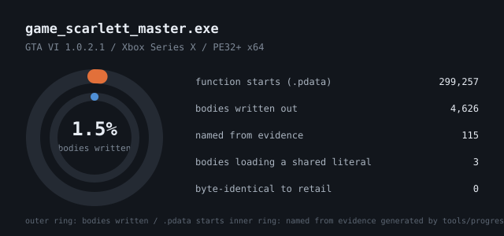
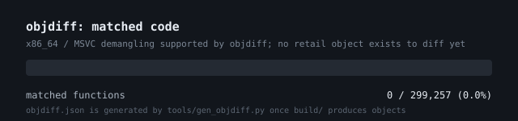

# florida-dc

The project is **florida-dc**; the working tree and the paths in the commands
below are `gta6decomp/`.

Recovered, source-shaped view of **GTA VI (Xbox Series X build, `game_scarlett_master.exe`, 1.0.2.1)**,
built with Ghidra + REA. Not a leak, not a disassembly dump, not a runnable game: it is decompiled
functions written the way RAGE code is written, with the evidence for every name attached to the body.

The naming and layout references are `MiscRef/GTAVSRC` (GTA V's source tree) and `gta_decomps/` (re3,
reVC, gta-reversed, openrw): subsystem folders, `Class::Method` names, one body per file. The logic is
GTA VI's.

## Progress





Both reports are generated by `tools/progress.py` from `index.tsv` and the image's `.pdata`, never typed
by hand. The first is the graph style isle publishes for its reccmp run; the second is the matched-code
bar a decomp.dev / objdiff project shows. The ring measures **bodies written out of 299,257 `.pdata`
starts**, because there is no source to compare against — it is coverage, not accuracy. The bar measures
**byte-identical functions**, which is 0 until a rebuild exists (see `docs/objdiff.md`).

## Current objective

**Objective 1 — RPF loading / extracting / streaming — level 5 of 10 ("Indexes").**
Under the working scale in `docs/progress-scale.md`, level 5 means real archives
list their real entries and every field of an entry is measured. That is met: the
table of contents decrypts on all 18 retail archives, and the column store behind
it parses into entries — offset, stored and unpacked size, flags, crypto record,
64-bit file id, and the 32-bit key the archive searches on. The C++ parse agrees
with an independent one on 1,081 entries.

Level 6 ("Decrypts") is blocked and located. Entry payloads are encrypted as well
as deflated: stored bytes do not inflate, and the crypto record names a key id and
a per-file IV. Those ids are live in the image's key list but belong to a
different white-box family (`0x2718ce5d`) than the TOC (`0x4e3b9b8e`), whose table
loader rejects them. That family's initialiser is `0x39ce1c0`; its argument order
and IV placement are not yet established, so 6 is not claimed — and 7 through 10
depend on it. The name heap is still encrypted, so entries are addressed by id
rather than by path.

`docs/progress-scale.md` defines the scale. Levels, in one list:

| Level | Name | Meaning |
|---|---|---|
| 1 | Nothing | no code |
| 2 | Anchors | literals/magics/entry candidates located, no body explained |
| 3 | Layout | structures proven field by field |
| 4 | Open path | construction path is readable C |
| 5 | Index | lookup layer is readable C |
| 6 | Read path | reading/decompressing is readable C |
| 7 | Write path | creating/packing is readable C |
| 8 | Streaming | async, prefetch, dependent archives |
| 9 | Integration | wired into the engine the way the build wires it |
| 10 | Finished | human-readable, evidence-backed, **byte-identical rebuild** |

| # | Objective | Level | Name |
|---|---|---|---|
| 1 | RPF loading / extracting / streaming | **5** | Index |
| 2 | Fuel | 2 | Anchors |
| 3 | Police & wanted | 2 | Anchors |
| 4 | Taunt / aggravate / diffuse / threaten | 1 | Nothing |
| 5 | Cameras (incl. vehicle slow-mo injury camera) | 2 | Anchors |
| 6 | Remaining subsystems | 1 | Nothing |
| 7 | Byte matching | 2 | Anchors (tooling built, 0 matched) |

The isle-style and objdiff images above are rendered artifacts; regenerating
them needs the Xbox image, which is not on this machine any more
(`tools/progress.py` reads `6RE/DUMP/game_scarlett_master.exe`), so they are
shown as last generated rather than recomputed. The objdiff base objects do
rebuild: `make -f objdiff.build.mk`.

## Objectives

The build order, in full, is in `docs/objectives.md`. Each objective ends with readable C for one
subsystem; byte matching is last because it is the only step that proves the C is correct.

| # | Objective | State |
|---|---|---|
| 1 | **RPF loading / extracting / streaming** | started — `RPF9` magic found in `.text`; PS5 entry index and directory scan recovered (level 5) |
| 2 | **Fuel** (tank, consumption, low-fuel state) | anchor only (`LOW_FUELH`) |
| 3 | **Police & wanted** (crime tracking, wanted level, dispatch) | anchors only (`Crime*`, `Wanted Tuning`) |
| 4 | **Taunt / aggravate / diffuse / threaten** | no string anchor; reached through the task tree |
| 5 | **Cameras**, including the vehicle slow-motion injury camera | anchor (`Camera_Move` → `FUN_03301850`) |
| 6 | remaining subsystems in `docs/layout.md` area order | not started |
| 7 | **Byte matching** every function | tooling ready, 0 matched |

### What the anchors proved

`%s.rpf`, `Crime Tuning`, `Wanted Tuning`, `LOW_FUELH` and `driverSettings_Rpf*` each appear exactly once
in the image and have **zero** code references, direct or through a pointer slot. They are hash-keyed
lookup data: names for a tuning/settings system, never instructions. Only `Camera_Move` is addressed by
code. So names tell us what data is called, never where a function is.

Structure comes from constants instead. `0x52504639` is `"RPF9"`, and it appears three times in `.text`,
in two functions:

| Function | Size | Reading |
|---|---|---|
| `FUN_00fc21c0` | 113 B | smallest body testing the magic — the version probe |
| `FUN_01fb2600` | 372 B | the archive header/entry reader |

`RPF0`, `RPF7` and `RPF8` appear zero times: this build reads RPF9 only. Those two bodies are objective 1's
entry points, and they are already reconstructed with names in
`src/sub_story/rage/base/file/packfile.cpp`: a 64-byte header (`magic`, `tocEnd`, `namesOffset`,
`entryCount`, `mode`, ...), a 0x60-byte file object (device `+0x10`, handle `+0x18`, size `+0x30`, path `+0x38`) and a
0x80-byte packfile object (`file +0x08`, header `+0x18`, names `+0x20`), plus the full open chain
`mount → open → Initialise → device/handle → ReadHeader` walked with `tools/callers.py`. `tools/anchors.py --all` regenerates the anchor table into `matches/objective_anchors.tsv`,
and `tools/organize.py` files any body an anchor proves into its GTAVSRC directory.

### Archive encryption

An RPF's payload is plain deflate, but its table of contents is encrypted, and
without the TOC there are no names or entry boundaries. On the Xbox Series X
build the recovered open path (`FUN_140fc2540 → FUN_141fb2600 → FUN_141fb2780 →
FUN_1408ec200 → FUN_14087aec0`) reads the table as opaque bytes, and the RAGE AES
block that would cipher it (`FUN_0215f06c`, the only code loading `TE0`/`TD0`/
`rcon`; dispatcher `FUN_021a8e3d`) has only HTTP callers there
(`FUN_0218809a` builds `CLNT`/`SRVR`). It is not CNG: the image imports
`BCryptOpenAlgorithmProvider` and `BCryptGenRandom` and **no**
`BCryptEncrypt`/`BCryptDecrypt`.

The PS5 build settles it. Its open path (`0x8e0990`) and TOC init (`0x8e1100`)
reach a keyed cipher through a vtable instead of by direct call, which is why
earlier sweeps found no caller: the cipher only runs once a readiness flag at
`0xac6e511` is set, and until then the path decompresses a `0x4feac`-byte global
block instead. Driven with that flag set, the game's own routine decrypts the
table of contents of every retail archive, in two stages:

| Stage | Range | Key | Result |
|---|---|---|---|
| 1 | `[A, B + bsz)` | header selector `+0x2E >> 1` | `[A, B)` then `[B, B+bsz-tail)` pass on all 18 archives |
| 2 | `[B+bsz-tail, idx_end)` | the key and IV named by section 1 | recovers three exact column hashes on all 18 |

The keys come from the 24-record list at `0x9ed4620`, reached from `0xb08740`;
its pointers are filled by the ordinary `DT_RELA` table (`0xe7d14c8`, 621,619
entries), not `PT_SCE_RELA`. Six are live — section 1 names `0x1000000f` through
`0x10000014`, one per archive. The cipher is white-box rather than AES: a key id
resolves to a `0x10f4`-byte blob with magic `0x4e3b9b8e`, holding 60 big-endian
dwords and 16 S-box tables, and all ten blobs decode to 16/16 bijective
permutations.

No key is committed. `tools/rpf9key.py` resolves ids and verifies the tables,
`tools/rpf9wb.py` runs the game's own decryptor natively, and `tools/rpf9cols.py`
dumps the decrypted table of contents; `docs/evidence/rpf9-toc-transform.md` is
the full record.

What the plaintext buys is the store behind it. The table of contents is not an
entry array but a **column store**: a section table, a column table, a row index
and the column data, with rows as files and columns as one attribute each.
`src/file/packfile_rpf9.cpp` (`Rpf9Toc`) parses it, and the six column hashes —
file entry, resource entry, crypto record, file id, the 4-byte equality-searched
key, and one direct 8-byte column — are identified from the code that names them.
Every archive's rows now resolve to real records, and the parse agrees with an
independent one on 1,081 entries across four archives.

The PS5 build is `RPF9` only like the Xbox one, its own AES is AES-NI rather than
the RAGE table block (which nothing loads there), and its open body is inlined
enough to show the header
layout arithmetic in full, which is now `fiPack_ComputeLayout` in `packfile.cpp`.
`docs/ps5-build.md` has the container, the loader and the recovered addresses;
`tools/ps5elf.py` is the loader. Its `p_offset` values are image offsets and the
SELF stores each segment in its own block, so the loader resolves segment to
block by exact length: reading text at `0x4000` reads 280 KB of zero padding and
shifts every address by `0x445d0`. `docs/ps5-symbols.md` has the correction, the
three measurements behind it, and what the image keeps symbolically — the
46-library import manifest (`tools/ps5imports.py`), the AGC and shader names, and
the encrypted state of every firmware module.

`docs/rpf-crypto.md` keeps the header evidence and records the AES hypothesis
that this work superseded. The header is 64 bytes, not 16, and the name region is
`align16(entryCount * (8 + mode))` bytes — exact on every archive in the dump,
which is what `rpf9crypt info` checks without a key. The AES block
(`src/sub_story/rage/base/data/aes.{h,cpp}`, `fiPackCrypt` in
`packfile_crypt.h`, `tools/rpf9crypt.cpp`) stays in the tree as the engine's own
block; it is not what RPF9's table of contents uses.

Keys are never in the repo (`keys/*` and `*.keyring` are ignored; `keys/README.md`
is tracked). `tools/rpf9keyhunt.cpp` scans an image for a key by decrypting an
archive's padding block with every aligned window: 7,210,119 32-byte windows of
this image, zero hits, and its self-test plants a key and finds it, so the
negative is the image. The only RAGE key array left in 1.0.2.1 is the GTA V
Durango key at RVA `0x65b5758`, and it does not open an RPF9 archive.

## Layout

```
gta6decomp/
├── src/sub_story/game/<area>/<Function>/<Function>.cpp   the root the image's PDB path names
├── src/sub_story/rage/<layer>/<Function>/<Function>.cpp  GTAVSRC's dev_ng split, VI's root
├── include/gta6decomp/rage_types.h              primitive/RAGE type shim
├── include/gta6decomp/natives.h                 script natives, in the GTA V PS4 header's shape
├── include/gta6decomp/<Class>.h                 declarations collected per recovered class
├── index.tsv                                    address, size, name, subsystem, strings, file
├── INDEX.md                                     index rendered by source directory
├── imports/gdk_symbols.tsv                      DLL, function, prototype, IAT RVA
├── names/gtav_classes.tsv                       GTA V class vocabulary (26,873 unique)
├── names/exe_paths.tsv                          layout paths recovered from the image's strings
├── names/native_hashes.tsv                      GTA V PS4 native vocabulary, presence per hash
├── matches/                                     string, byte-marker and objective-anchor evidence
├── build/                                       (objdiff output root; created on first build)
├── objdiff.json                                 objdiff unit inventory
├── attic/                                       earlier export layouts, kept for comparison
├── tools/                                       PE/ELF readers, matchers, generators, Ghidra scripts
├── skills/ghidra-headless/                      the working Ghidra recipes + MCP options
├── wiki/                                        project memory (Obsidian-compatible pages)
└── docs/                                        objectives, layout, matching toolchain, reports
```

`src/sub_story` is not a guess: the image carries its own build path,
`X:/americas/src/sub_story/game/vs_project/Gaming.Xbox.Scarlett.x64/Build/master/game_scarlett_master.pdb`,
so the VI analogue of GTA V's `src/dev_ng` is `src/sub_story`. Directories follow GTA V's own tree:
a body is filed under the GTA V source directory of the function it matched, then under the content
namespace it loads (`common:/data/ai/...` → `game/ai`), then under its subsystem. The rules and the
evidence tiers are in `docs/layout.md`.

## Status (measured on this machine)

| Step | Result |
|---|---|
| Program imported into `ghidra_proj/gta6_full` | PE32+ x64, base `0x140000000`, **298,743 functions** |
| `.pdata` exception entries | **299,257** function starts (the denominator the reports use) |
| PE import table represented | **587 external symbols**, 307 external functions, 563 IAT slots labelled `__imp_*` |
| GDK / Win32 prototypes on those externals | **269 of 307** |
| GTA V class vocabulary in the Data Type Manager | **27,903** opaque types under `/gtav/<namespace>` |
| GTA V source → executable name transfer | 148,314 literals scanned, 295 found, **130 functions tied, 115 named in the tree** |
| GDK / GTA V PS4 / RDR2 byte markers | 1,300 + 122,153 + 147,119 function ranges fingerprinted, **0 body matches** (`docs/byte-markers.md`) |
| GTA V PS4 native hashes found in the image | **0 of 6,691** (`docs/objectives.md`) |
| Exported bodies | **4,626** (one folder per function) under the recovered `src/sub_story` tree |
| Hand-written readable code | **4 files** — `src/sub_story/rage/base/file/packfile.cpp` (RPF9 file + packfile objects, whole open path), `packfile_crypt.h` (64-byte header + TOC cipher + geometry), `src/sub_story/rage/base/data/aes.cpp` (the AES block), `src/sub_story/game/Core/FUN_14087b0f0/FUN_14087b0f0.cpp` (the TOC geometry walk, hand-disassembled), syntax-clean under `g++ -Wall -Wextra` |
| Archive TOC encryption | **decrypted**: the PS5 build's own keyed cipher reproduces the TOC on **all 18 retail archives** (two stages, six live key ids, white-box blobs rather than AES); the column store behind it parses into real file records and the six column hashes are identified (`docs/evidence/rpf9-toc-transform.md`) |
| objdiff units | **4,626**, of which 3 have built clang-cl base objects (`packfile.obj`, `aes.obj`, `FUN_14087b0f0.obj`) and **0** have a retail target object |
| Byte-identical functions | **0** (no rebuild to diff yet) |
| PS5 symbol pass | `REFS` line produced with `-noanalysis`: **46** libraries, **7** RAGE structs, **43** fields, **27,903** GTA V classes; `renamed_total=0` because no match file exists yet (`docs/ps5-build.md`) |
| Shader compilers decompiled | **11,662** functions from `orbis-psslc.exe` and **15,571** from `prospero-wave-psslc.exe` (`tools/DumpAll.java`, 3 failed each); trees are generated, not committed (`wiki/reference/shader-compilers.md`) |
| PS5 eboot imports named | **730 stubs, 713 named** from the GhidraProspero NID database and **17 module-only** from the `ps5-nid-map` corpus (`names/ps5_eboot_imports.tsv`); all 730 applied into the Ghidra project, 0 skipped |
| PS5 import names | **3,407** `sce*` symbols encoded to NIDs from the Sony 11.000 and payload SDK headers (`tools/ps5nids.py`); encoder verified 3/3 against the AnyDevKit NID map |
| PS5 packfile index | keyed, not name-sorted: 4 constant record keys, `id = (packfileIndex << 16)` OR the entry id, TOC offset `entryId << 4` (`docs/ps5-build.md`) |

The old project `ghidra_proj/game_scarlett_master` is superseded: it was built from `.pdata` only, so it
had **0 external symbols** and no import typing. `gta6_full` is the project to use.

## Script natives

`include/gta6decomp/natives.h` follows `GTA-V-PS4-1.57/natives.h` line for line:

```c
static void WAIT(int ms) { invoke<Void>(0x2224A20, ms); } // 0x4EDE34FBADD967A6
```

The first argument is the native's handler address, the comment is the canonical 64-bit hash. Measured
against this image, **none of the 6,691 hashes in the GTA V PS4 header occurs as an 8-byte value**, so no
handler address can be carried over: GTA VI regenerated its native set. The header keeps the invocation
contract and the reference vocabulary, with `GTA6_NATIVE_RESOLVED 0`, and gains a line per native when the
script VM objective recovers the real table. `tools/natives.py` regenerates both it and
`names/native_hashes.tsv`.

## How the references get into Ghidra

`tools/ApplyRefs.java` is the single pass that loads everything, in this order:

1. **GDK + Win32 prototypes** (`imports/gdk_symbols.tsv`) onto the external locations, and `__imp_<Name>`
   labels on the IAT slots. Prototypes naming a type the program does not define degrade that type to
   `void*` instead of being dropped.
2. **GTA V classes** (`names/gtav_classes.tsv`) as opaque structures, namespaced like the source tree.
3. **GTA V source string transfer** (`matches/gtav_source_functions.tsv`): a literal that appears both in a
   GTA V source function and in the executable names the GTA VI function that loads it.
4. **Byte-marker matches** (`matches/bytes_*.tsv`), when a corpus produces any.

`tools/ApplyPs5.java` is the PS5 equivalent, with no GDK step: the 46 imported system libraries become
Ghidra external libraries, `names/rage_structs.tsv` (generated from the recovered RAGE headers by
`tools/make_ps5_types.py`) becomes real structures under `/rage`, and GTA V's classes come from the same
table as on Xbox. It prints the same `REFS|…` line, so `tools/progress.py` reads both builds.

## Byte markers, stated plainly

`tools/byte_markers.py` fingerprints functions from the GDK DLLs and from the GTA V and RDR2 PS4 eboots
(function starts from `.eh_frame_hdr`), indexes 8-byte shingles over all 19.75 M shingles of the image's
`.text`, and verifies candidates byte-by-byte with relocation positions masked.

The matcher is correct — a 300-function self-test finds its own index entry **291 times** — but **no
reference body reaches the 0.80 byte-equality threshold**. The GDK is imported rather than statically
linked, and the PS4 builds are clang while this executable is MSVC. The tool and the measured result are
in `docs/byte-markers.md`; it is kept because it is the right way to test a new corpus.

## Matching toolchain

`docs/toolchain.md` records the full assessment. In short: **objdiff** supports x86_64 and MSVC demangling
and is the tool for objective 7, but it diffs relocatable objects and a linked retail PE is not one, so
the matched count is 0. **reccmp** targets 32-bit x86 with MSVC 4.2 and cannot be pointed at this binary;
its annotation convention is already mirrored by the `// Address:` / `// Name:` body headers. **reprobit**
targets MSVC 4.2/5.0, but it defines the standard objective 7 is held to. **isle** supplies the progress
graph shape, which `docs/progress.svg` copies without its denominator. **cinnabar** is a Rust Minecraft
client, not a GDK port; only its `core/xboxpresence` package and `docs/profile-parity.md` are relevant
references later.

## Commands

```sh
HL=/home/nate/ghidra/ghidra_12.1.4_PUBLIC/support/analyzeHeadless
PROJ=ghidra_proj/gta6_full

# 1. import once (imports become external symbols)
MAXMEM=3000M $HL $PROJ gta6_full -import 6RE/DUMP/game_scarlett_master.exe -noanalysis

# 2. load references, apply naming and matches
MAXMEM=3000M $HL $PROJ gta6_full -process game_scarlett_master.exe -noanalysis \
  -scriptPath gta6decomp/tools -postScript ApplyRefs.java /home/nate/Port2PS4/gta6decomp

# 3. export a range, a count, or an address list (@file, one VA per line)
MAXMEM=3000M $HL $PROJ gta6_full -process game_scarlett_master.exe -noanalysis \
  -scriptPath gta6decomp/tools -postScript ReSource.java /home/nate/Port2PS4/gta6decomp 0x140001000 400 0
MAXMEM=3000M $HL $PROJ gta6_full -process game_scarlett_master.exe -noanalysis \
  -scriptPath gta6decomp/tools -postScript ReSource.java /home/nate/Port2PS4/gta6decomp @addrs.txt 0 0

# 4. rebuild index.tsv, the per-class headers, and the reports
python3 gta6decomp/tools/reindex.py && python3 gta6decomp/tools/make_headers.py
python3 gta6decomp/tools/progress.py
```

`ReSource` takes the body extent from `.pdata` when the program has not been analyzed, disassembles only
the functions it exports, and decompiles them on demand — a full `.pdata` pre-pass is optional.

Reference generation:

```sh
python3 gta6decomp/tools/gdk_imports.py        # PE imports -> GDK prototypes + IAT RVAs
python3 gta6decomp/tools/gtav_names.py         # GTAVSRC -> class vocabulary
python3 gta6decomp/tools/gtav_strings.py       # GTAVSRC literals -> executable strings
python3 gta6decomp/tools/resolve_strings.py    # string RVA -> function (RIP-relative, all phases)
python3 gta6decomp/tools/exe_paths.py          # layout paths the image still carries
python3 gta6decomp/tools/anchors.py --all      # objective literals -> functions (direct + pointer slot)
python3 gta6decomp/tools/natives.py            # natives.h + native_hashes.tsv
python3 gta6decomp/tools/gen_objdiff.py        # objdiff.json unit inventory
make -C gta6decomp -f objdiff.build.mk        # clang-cl base objects for hand-written units
python3 gta6decomp/tools/byte_markers.py --corpus gdk,gtav,rdr2
python3 gta6decomp/tools/funcmatch.py --rva 0x87b0f0 --size 0x34 \
    --obj gta6decomp/build/game/Core/FUN_14087b0f0.obj --symbol fiPack_ComputeRun

# 5. archive TOC cipher: self-test, then decrypt/encrypt an archive's TOC
g++ -std=c++17 -O2 -o gta6decomp/build/rpf9crypt gta6decomp/tools/rpf9crypt.cpp \
    gta6decomp/src/sub_story/rage/base/data/aes.cpp
./gta6decomp/build/rpf9crypt selftest
./gta6decomp/build/rpf9crypt info common.rpf        # header + geometry, no key
./gta6decomp/build/rpf9crypt decrypt common.rpf common.clear.rpf --key keys/rpf9.key

# 5b. key hunt: every aligned window of an image against an archive's padding block
g++ -std=c++17 -O2 -o gta6decomp/build/rpf9keyhunt gta6decomp/tools/rpf9keyhunt.cpp \
    gta6decomp/src/sub_story/rage/base/data/aes.cpp
./gta6decomp/build/rpf9keyhunt selftest
./gta6decomp/build/rpf9keyhunt scan 6RE/DUMP/game_scarlett_master.exe \
    6RE/DUMP/appdata0.rpf 6RE/DUMP/script.rpf --keylen 32
```

## Limits

- Names come from evidence only: GTA V source literals, recovered classes, GDK imports. A body that loads
  no shared literal keeps `FUN_<address>`.
- RAGE 9 hashes gameplay vocabulary, so `CTaskHoldup`-style names are not recoverable from strings; the
  gameplay name pool in `.text` has no code cross-references. The `Crime*` block is the exception.
- PS4 and RDR2 contribute function ranges and bytes, not names: those eboots are stripped and carry no
  symbol table, no MSVC RTTI and no Itanium vtable names.
- Coverage is partial: 4,626 of 299,257 starts are written out. The machinery to export more is the same
  command with a longer address list.
- The RPF9 TOC is decrypted on the PS5 build, but its key is not a constant in
  the Xbox image: all 7,210,119 aligned key windows fail the padding test, the one
  RAGE key array left in 1.0.2.1 (the GTA V Durango key at RVA `0x65b5758`) does
  not open an archive, and the cipher is white-box, not AES.
  `tools/rpf9keyhunt.cpp` re-runs that experiment.
- Entries are addressed by id, not by path: the name heap is encrypted with a key
  the image does not expose here, so `common.rpf` lists 418 rows and none of them
  has a recovered name.
- Decompiled C is not original source. Locals keep Ghidra's `param_1` / `local_XX`; struct layouts are only
  known where a body reads a fixed offset.
